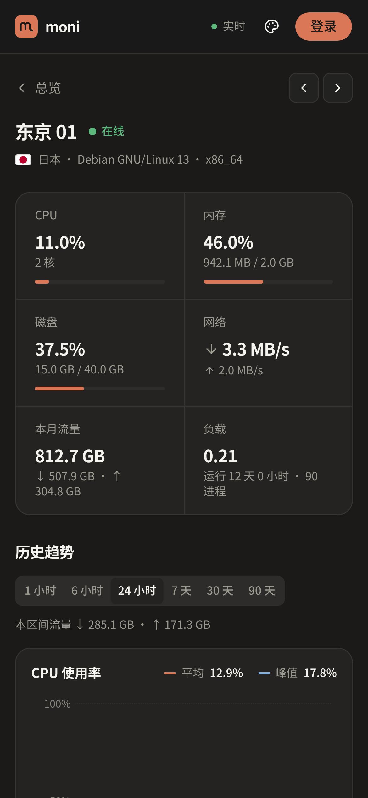
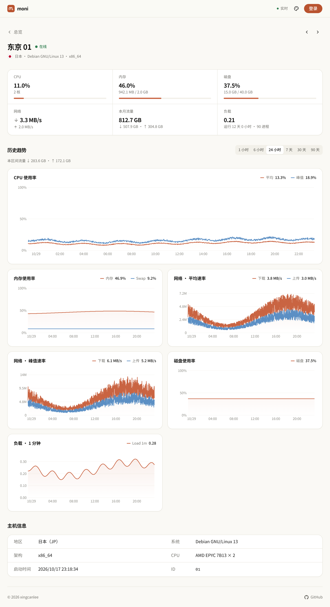

# moni-rs

[](https://github.com/xingcanlee/moni-rs/actions/workflows/ci.yml)
[](https://github.com/xingcanlee/moni-rs/actions/workflows/deploy.yml)
[](LICENSE)

**简体中文** | [English](README.en.md)

用 Rust 编写的 VPS 监控，完全运行在 **Cloudflare 免费额度**内：不需要自建服务器，Fork 后填好 Secrets，用 GitHub Actions 一键部署。


## 特点

- **零成本、零运维**：后端是编译为 WebAssembly 的 Rust Worker 加一个单例 Durable Object（内置 SQLite），前端作为 Workers 静态资源托管。没有数据库、服务器或容器要维护。
- **实时**：Agent 和看板都通过可休眠的 WebSocket 连接。有人查看时每 2 秒推送一帧，无人查看时自动降到 30 秒，节省额度。
- **数据不丢**：Agent 每秒采样，每分钟上报一条聚合数据，确认后才出队。断网期间最多缓存 24 小时，重连后补发。
- **历史与流量**：提供 1 小时到 90 天的历史曲线（CPU、内存/Swap、网络、磁盘、负载），并统计每台服务器的本月流量。
- **告警**：支持阈值告警和离线告警，通过 Telegram 或 Webhook 通知。
- **安全**：每台服务器使用独立 token，比较时间恒定。Agent 以非 root 用户运行并启用 systemd 加固，升级包需要通过 RSA 签名和 SHA-256 校验，失败时自动回滚。
- **公开只读看板**：访客可以查看总览和历史，但看不到主机名、内核、IP、token、告警规则等敏感信息。管理功能需要登录。
- **7 套主题、明暗模式和移动端适配**：管理员可以设置站点默认主题，访客也可以自行切换。

## 性能指标

| 项目 | 数据 |
|---|---|
| Agent 内存 | RSS 约 4 MB，CPU ≈ 0% |
| Agent 体积 | musl 静态二进制，约 3 MB（amd64 / arm64） |
| Worker 包体积 | 约 890 KiB wasm（gzip 后约 340 KiB），免费计划上限为 3 MiB |
| 前端体积 | 首页 JS 约 232 KB、CSS 约 20 KB（gzip）；详情与管理页按需加载 |
| 采样 / 上报 | 1 秒采样；实时帧间隔 2 秒（有人查看）或 30 秒（无人查看）；每分钟 1 条聚合数据 |
| 数据保留 | 分钟粒度 7 天，小时粒度 90 天 |
| 免费额度容量 | 约 **30 台**服务器，瓶颈是 SQLite 每日写入行数（每台约 3k 行/天），详见 [design §5.4](docs/design.md) |

## 截图

<table>
  <tr>
    <td><br><sub>陶土 · 暗色</sub></td>
    <td><br><sub>赛博朋克</sub></td>
  </tr>
  <tr>
    <td><br><sub>Material</sub></td>
    <td><br><sub>Cloudflare</sub></td>
  </tr>
  <tr>
    <td><br><sub>终端</sub></td>
    <td><br><sub>Nord</sub></td>
  </tr>
  <tr>
    <td><br><sub>Geist</sub></td>
    <td><br><sub>陶土 · 亮色（默认）</sub></td>
  </tr>
</table>

**移动端**

<p>
  
  
</p>

<details>
<summary>服务器详情页</summary>



</details>

## 快速开始

整个过程只用浏览器完成，本地不需要安装任何工具。

1. **准备 Cloudflare**：登录后打开一次 **Workers & Pages**，完成 `*.workers.dev` 子域注册。记下 **Account ID**，再用 *Edit Cloudflare Workers* 模板创建一个 **API Token**。
2. **Fork 本仓库**，在 **Actions** 页签中启用 workflows。
3. **添加 Secrets**（Settings → Secrets and variables → Actions）：

   | Secret | 必填 | 说明 |
   |---|:---:|---|
   | `CLOUDFLARE_API_TOKEN` / `CLOUDFLARE_ACCOUNT_ID` | ✅ | 第 1 步获取的凭据 |
   | `ADMIN_PASSWORD` | ✅ | 看板登录密码 |
   | `AUTH_SECRET` | ✅ | 至少 32 字节的随机串，可用 `openssl rand -hex 32` 生成。**更换后所有会话和 Agent token 都会失效** |
   | `TG_BOT_TOKEN` / `TG_CHAT_ID` / `WEBHOOK_URL` | | 可选，告警通知渠道 |

4. **部署**：运行 **Actions → Deploy → Run workflow**。完成后，Summary 中会显示 `https://moni-rs.<子域>.workers.dev`。
5. **发布 Agent**：推送一个 `v*` tag（例如 `v0.1.2`），**Release agent** 会构建 amd64 / arm64 二进制并附加到 Release。签名需要 `AGENT_RELEASE_SIGNING_KEY`，配置方法见 [agent-updates.md](docs/agent-updates.md)。仓库需要公开。
6. **接入服务器**：在看板中打开 **设置 → 服务器 → 添加服务器**，复制安装命令，在 VPS 上以 root 执行：

   ```sh
   curl -fsSL https://github.com/<owner>/moni-rs/releases/latest/download/install-agent.sh \
     | sudo sh -s -- --repo <owner>/moni-rs \
         --server wss://moni-rs.<subdomain>.workers.dev/ws/agent \
         --token mn_<server_id>_<secret>
   ```

升级时不带参数重新执行安装命令即可；加 `--auto-update` 会每 6 小时检查一次新版本。卸载使用 `sudo sh install-agent.sh --uninstall`。可选配置见 [scripts/agent.env.example](scripts/agent.env.example)。

## 本地开发

需要 Rust ≥ 1.94（含 `wasm32-unknown-unknown` target）、`worker-build` 0.8.7、Node 22+ 和 pnpm 10。

```sh
pnpm install && cp crates/worker/.dev.vars.example crates/worker/.dev.vars
pnpm build:web
pnpm dev                                      # http://127.0.0.1:8787
cargo run -p moni-agent -- --server ws://127.0.0.1:8787/ws/agent --token mn_xxx_yyy
scripts/e2e.sh --quick --ui                   # 端到端测试 + 浏览器冒烟测试
pnpm --filter moni-web screenshots           # 用模拟数据重新生成 docs/screenshots
```

## 常见问题

**中国大陆无法访问？** `*.workers.dev` 在大陆无法直接访问。请在 Worker 中绑定一个托管在 Cloudflare 的自定义域名，安装命令中的 `--server` 也要改用这个域名。

**不想公开看板？** 把 `crates/worker/wrangler.jsonc` 中的 `PUBLIC_DASHBOARD` 改成 `"false"`，然后重新部署。

## 文档

[架构](docs/architecture.md) · [设计](docs/design.md) · [API](docs/api.md) · [Agent 签名更新](docs/agent-updates.md) · [ADR](docs/adr/)

## License

[MIT](LICENSE) © xingcanlee
